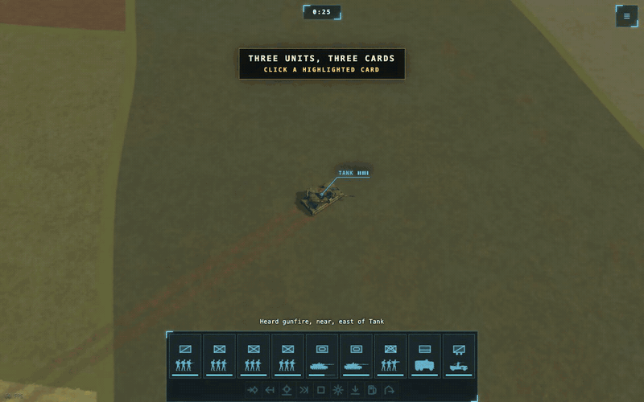

# Unit card camera focus

Clicking a card already selected in the army deck, or double-clicking any card,
puts the camera's orbit target on that unit's ground position. The request
keeps the current yaw, pitch and zoom, and the viewport runs the same
camera-clearance pass as `N` / `Shift+N`. Presentational only: no observation,
command, rule or digest changes.

## Why

The army deck is where a player finds a unit; the map may be looking somewhere
else. `N` / `Shift+N` already jumps through enemy contacts, so the same gesture
for the player's own units removes a manual pan. The card is the smallest
surface that already names a unit, so it owns the gesture instead of a new
button or marker.

Three shape decisions follow:

- **Click, not a new control.** A selected card already means "this unit is the
  selection"; clicking it again has no selection work to do, so it is the
  natural place for "show me this one". A double-click on an unselected card
  needs no second gesture path: the first click selects it, and the second
  click is now a click on a selected card.
- **One camera owner.** `LabViewport`'s `centerOn` is the helper
  `N` / `Shift+N` already uses. The page supplies only a ground point; the
  viewport keeps its yaw, pitch and distance, applies `groundAt`, and lets
  clearance resolve the drawn pose. No route owns a second camera.
- **Modified clicks stay selection gestures.** Shift/Ctrl/Meta/Alt clicks keep
  their existing selection meaning and never move the camera. Replay and
  scripted battles pass no `onCenter`.

## Invariants

- **Only an already-selected, unmodified card asks for a move.** `ArmyDeck`
  checks the id the card selects (`picks`, the carrier for a rider) in
  `selected` before calling `onCenter`, and still calls `onSelect` first, so
  selection semantics are unchanged.
- **Every ask is a new ask.** `useUnitFocus` returns a fresh
  `{ token, target }` per call, and `LabViewport` applies a request once per
  token. Clicking the same card again after panning away moves the camera
  again.
- **A request never overrides a script or disabled input.** `LabViewport`
  applies it only when `!piloted && inputEnabledRef.current`; a request that
  arrives while input is off is consumed and ignored.
- **The contract is optional.** The panel, UI and other camera-less galleries
  supply no `onCenter` and no `cameraFocus`, so they keep their previous
  behavior.
- **The target is the ground footprint of the unit the card selects.** A
  rider's card selects and centres its carrier, so the request uses that
  carrier's `position[0..1]`, not a soldier's spot or an aircraft's altitude.

## Pointers

- Card gesture and `onCenter`: `ArmyDeck` in
  `web/src/battle/present/armyDeck.tsx`.
- Request token and unit-to-ground-point conversion: `useUnitFocus` in
  `apps/battle-lab/src/useUnitFocus.ts`.
- Camera contract and one-shot application: `CameraFocusRequest`,
  `cameraFocus` and `centerOn` in `apps/battle-lab/src/LabViewport.tsx`.
- Production wiring: `BattleView` in `apps/battle-lab/src/BattleView.tsx`.
  The readouts lab mirrors it in
  `apps/battle-lab/src/routes/readouts.tsx`.
- Tests: `web/tests/armyDeck.test.tsx` (the card gesture) and
  `web/scenes/readouts.mjs` (selected click, repeat click, double-click).

## Visual provenance

The standard is the game's existing HUD and camera: the card keeps its
published look, and the focus move keeps the same angle and zoom as
`N` / `Shift+N`. No new visual surface was introduced, so no baseline picture
changed.

The GIF is a recorded review aid from `/labs/street`: three own units are moved
to different parts of the map with lab commands, then the selected-card and
double-click gestures switch between them. It shows the gesture, not a battle
outcome.

## Dead ends

- **A new focus button or marker.** The card already names the unit; a second
  surface would duplicate the concept and add chrome.
- **An animated move or zoom-to-fit.** The requested behavior is the
  `N` / `Shift+N` cut, which preserves the current framing. Animating or
  changing zoom would be a different feature.
- **Centering on the unit's altitude.** The rig and `N` both target the ground
  plane; using a flying unit's Z would leave the orbit in the air.
- **A separate `dblclick` handler.** The second click already sees the selected
  card. A second handler would duplicate the camera request and create a
  parallel gesture path.
